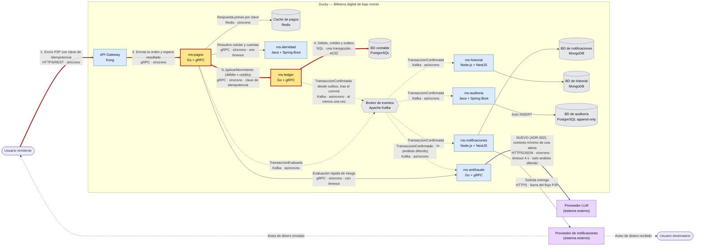

# Vista de contenedores (C4 nivel 2) — Transferencia P2P y análisis antifraude asistido

Sistema: **Ducky — Billetera digital de bajo monto** · Caso 2 · Grupo 2 · UFPS 2026-II

Esta vista parte del DSL aprobado en el ADR-001 (flujo de transferencia entre usuarios, RF-03) y le agrega, **sin alterar ese flujo**, el proveedor externo del modelo de lenguaje decidido en el ADR-002. El mismo modelo está en [`contenedores.dsl`](contenedores.dsl).

## Diagrama

Convenciones: flecha continua = síncrona (el que llama espera respuesta) · flecha punteada = asíncrona (evento por Kafka o entrega externa) · **flecha roja gruesa = camino del escenario elegido** (reintento de transferencia con respuesta perdida: `ms-pagos` → `ms-ledger`) · contenedores en naranja = los dos que implementa el prototipo (`src/`) · en morado = proveedor del modelo de lenguaje.

## Camino del escenario (flechas 1 a 4)

Escenario 1 — reintento de transferencia con respuesta perdida (atributo: integridad):

1. El usuario envía la transferencia con su `clave_idempotencia`; el Gateway la enruta a `ms-pagos` (HTTPS y gRPC, ambos síncronos).
2. `ms-pagos` llama a `ms-ledger` con `AplicarMovimiento`. **Esta es la llamada donde se pierde la respuesta**: el ledger confirma, pero el cliente no se entera y reintenta con la misma clave.
3. `ms-ledger` aplica débito, crédito y evento outbox en una sola transacción ACID sobre la BD contable. La unicidad de la clave de idempotencia es la que evita que el reintento vuelva a mover dinero.

El prototipo del repositorio (`src/`) implementa únicamente estos dos contenedores (`ms-pagos` → `ms-ledger`), con el ledger en memoria en lugar de PostgreSQL. El resto de la vista es el diseño completo y **no está implementado**.

## Proveedor del modelo de lenguaje (ADR-002)

| Aspecto | Valor | Origen |
|---|---|---|
| Quién lo llama | `ms-antifraude`, mediante un adaptador del análisis diferido | ADR-002 (extensión propuesta, no implementada) |
| Protocolo | HTTPS/JSON | ADR-002 |
| Síncrono o asíncrono | Síncrono: el adaptador espera la respuesta del proveedor. Es asíncrono respecto del pago, porque ocurre después de consumir `TransaccionConfirmada` desde Kafka | ADR-002 |
| Timeout | **4 s**. Es un supuesto de diseño del grupo, no una cifra del caso ni una medida observada | ADR-002 |
| Si falla o no responde | Se conserva la alerta determinista y se pasa a revisión manual; no se reintenta indefinidamente | ADR-002 |
| Lo que NO toca | El camino síncrono `ms-pagos` → `ms-antifraude` (reglas) → `ms-ledger`. Ninguna flecha del LLM llega a `ms-pagos` ni a `ms-ledger`, y el modelo no bloquea cuentas ni modifica saldos | ADR-002 |

## Timeouts: qué está definido y qué no

El ADR-001 dice que `ms-pagos` llama con **timeout y circuit breaker** a `ms-identidad`, `ms-antifraude` y `ms-ledger`, pero **no fija un valor en milisegundos** para el envío P2P. Lo único cuantificado es la reserva de unos 400 ms al ledger dentro del presupuesto de 2 s del pago QR. Por eso el diagrama dice "con timeout" sin inventar un número; el único timeout con valor es el del LLM (4 s, supuesto).
